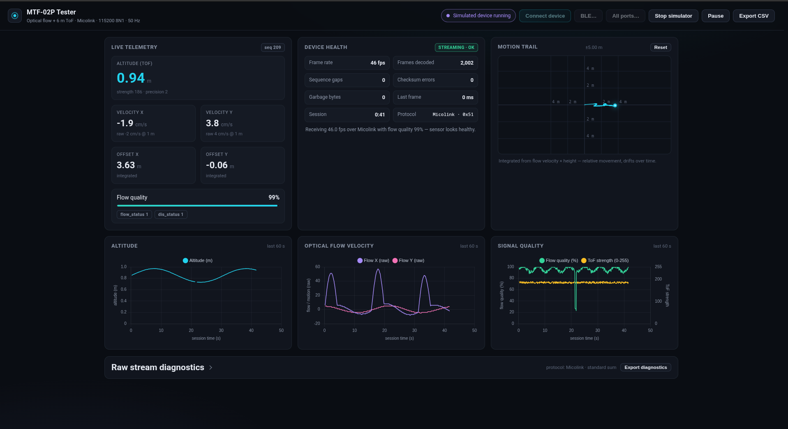

# MTF-02P Tester

A single-page TypeScript app for testing the **MicoAir MTF-02P** optical flow + ToF rangefinder module in the browser over **Web Serial**, using the vendor's **Micolink** protocol.



## What it shows

- **Live telemetry**: altitude (ToF, m), optical flow velocity X/Y (cm/s at real height, raw cm/s @ 1 m), integrated X/Y position offset
- **Motion trail**: top-down auto-scaling XY scope of the integrated movement
- **Charts** (60 s window): altitude, flow velocity X/Y, flow quality + ToF strength
- **Device health**: measured frame rate, sequence gaps, checksum errors, garbage bytes, last-frame age, and an overall verdict (STREAMING OK / DEGRADED / WRONG PROTOCOL / SIGNAL LOST) that tells you whether the sensor is working as expected
- **Extras**: CSV session export, pause/resume, motion-trail reset, and a built-in device simulator that feeds synthetic Micolink frames through the exact same parser

## Run it

```bash
npm install
npm run dev      # then open the printed http://localhost:5173 URL
```

A production build: `npm run build` (output in `dist/`, serve over HTTPS or localhost — Web Serial requires a secure context).

Parser sanity check without hardware: `npm run sanity`.

## Connecting the sensor

The MTF-02P speaks 3.3 V LVTTL UART — use a USB-TTL (e.g. CP2102) adapter, **not** an RS232 one:

| MTF-02P | USB-TTL adapter |
| ------- | --------------- |
| 5V      | 5V              |
| GND     | GND             |
| Tx      | RXD             |
| Rx      | TXD             |

Then press **Connect device** and pick the adapter's serial port. The port picker is filtered to common USB-UART bridges (FTDI, CP210x, CH340/CH910x, PL2303, Pico, ESP32 native USB, Arduino, ST CDC), which hides built-in ports like `/dev/ttyS*` — use **All ports…** if your adapter is not from those families. Settings are fixed at 115200 8N1 (the sensor's only mode).

## Browser support

Web Serial needs **Chrome, Edge or Opera on desktop** (localhost or HTTPS). Other browsers can still use the **Simulate** mode.

**Bluetooth serial works too**:

- **Bluetooth Classic SPP**: pair the device in your OS Bluetooth settings, then use **Connect device** (or **All ports…**) — Chrome 117+ lists paired SPP devices alongside USB bridges. Baud rate is ignored over RFCOMM.
- **BLE** (button **BLE…**): works with BLE-serial bridges exposing a UART-like GATT service — Nordic UART Service (`6e400001…`), the HM-10/AT-09/JDY-class `FFE0/FFE1` service, or JDY-31-class `FFF0/FFF1`. Select the device in the browser picker (no OS pairing needed); there is no baud rate on BLE GATT, and throughput is bounded by the connection interval. Data still flows one way (sensor → app), which is all this sensor needs.

Either way the MTF-02P has no radio of its own: a wireless path requires a serial-to-Bluetooth bridge module wired to the sensor's UART (sensor TX → bridge RXD).

## Protocol notes

The module supports MAVLink (ArduPilot/PX4), MSP (INAV) and **Micolink**; current-production units **auto-detect the flight controller on power-up**, otherwise select a protocol via the solder pads or [MicoAssistant](https://micoair.com/assistant/). This app supports:

**Micolink** (frame `0xEF | dev_id | sys_id | msg_id | seq | len | payload | checksum`, checksum = byte sum of everything before it):

- Message `0x51 RANGE_SENSOR` payload (20 bytes, little-endian): `time_ms u32`, `distance u32` (mm, 0 = unavailable), `strength u8`, `precision u8`, `dis_status u8`, `rsvd`, `flow_vel_x i16`, `flow_vel_y i16` (cm/s @ 1 m), `flow_quality u8`, `flow_status u8`, `rsvd u16`
- Real velocity = `flow_vel × height(m)`

**MSP v2** (`$X` frames, CRC-8/DVB-S2 poly 0xD5):

- `0x1F01 MSP2_SENSOR_RANGEFINDER`: `strength u8`, `distance i32` (mm, negative = invalid)
- `0x1F02 MSP2_SENSOR_OPTIC_FLOW`: `quality u8`, `motion_x i32`, `motion_y i32`
- The two arrive as separate frames at ~50 Hz each; the app pairs the latest range with each flow frame. **Motion values are shown raw** — their scaling is not documented, so the velocity readout is an estimate (`motion × height`) and the health hint says so.

Both decoders run on the same stream initially, and a **protocol gate** auto-detects which one the device speaks (lock requires ≥3 valid checksum/CRC-verified frames, or a checksum-variant lock — never noise). Once locked, the gate stays on that protocol for the whole session and feeds bytes to that decoder only, so **all error metrics are protocol-relative**: "garbage bytes" means bytes that do not belong to a valid frame of the *detected* protocol, and is ~0 on a healthy stream. The health panel shows the detected protocol (`Micolink · 0x51` / `MSP v2 · $X`) and a `DETECTING` verdict while the gate is still deciding.

The Micolink decoder matches the vendor's sample code and the [Micolink protocol reference](https://docs.robofusion.net/developer/micolink-protocol) byte-for-byte, and everything is covered by automated sanity checks (`npm run sanity`).

## Troubleshooting with the Raw stream diagnostics card

If the health badge says **WAITING / WRONG PROTOCOL / NO DATA**, the diagnostics card shows what is actually arriving on the wire:

- **Signature-byte counters** (`0xEF` Micolink, `0xFD/0xFE` MAVLink v2/v1, `$` MSP v2, `0x59` TFmini) reveal which protocol the module is really streaming — community reports show MTF modules frequently auto-detect or default to MSP/MAVLink rather than Micolink, even when the user believes Micolink is selected.
- **Hex dump** of the newest 96 bytes lets you eyeball `$X<` (MSP), `FD…` (MAVLink v2) or `EF 0F…` (Micolink) frames directly.
- **Checksum probe**: if `0xEF` frames arrive but every checksum fails under the published sum rule, the app automatically probes XOR / inverted-sum / inverted-XOR variants (gated on ≥6 consecutive frames with sequence and timestamp continuity to avoid noise false-positives) and switches decoding when one locks in.
- **Export diagnostics** dumps counters, verdict and the raw byte sample to a JSON file for issue reports.

Typical outcomes: `NO DATA` → wiring (module TX → adapter RX) or power; a stream of `$X…` bytes → MSP v2 frames decode automatically (no action needed); `MAVLINK v2/v1 DETECTED` → the module is in ArduPilot/PX4 mode, switch to Micolink or MSP if you want this app; `UNKNOWN STREAM` with noise-level signature counts → floating adapter RX line or wrong baud.

## Sensor operating limits (for troubleshooting)

- Optical flow needs > 60 lux ambient, a textured surface, and > 8 cm working distance
- ToF: 6 m @ 90% reflectance indoors, 4 m in bright sun (70 klux); 2 cm dead zone; readings over low-reflectivity surfaces (grass, dark asphalt) come up short
